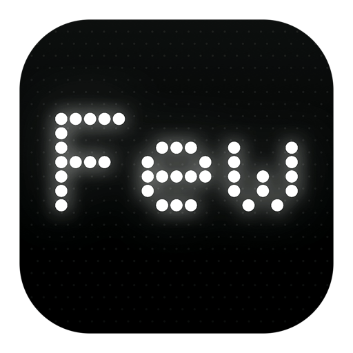

# FewNote — a typewriter for the Mac, drawn in dots.

<p align="center">
  
</p>

<p align="center">
  <strong>An ultra-lightweight, native macOS notepad. Open it, type, close it. That's it.</strong>
</p>

<p align="center">
  <a href="https://zakhefron.github.io/few-note-site/">Live site</a> ·
  <a href="https://github.com/zakhefron/few-note">Source</a> ·
  <a href="#install">Install</a>
</p>

<p align="center">
  
  
  
  
  
</p>

<p align="center">
  
</p>

> Every character is drawn dot by dot on a dim field — the text is never drawn, the dots are.

---

## Why it's different

- **A real dot matrix, not a font on a grid.** 237 hand-built glyphs lit on a dim field. `café`, `über`, `Kraków`, `naïve` all render as themselves.
- **Nothing to learn.** No syntax, no markers, nothing to interpret. Smart quotes are off, so a `#` is a `#`.
- **Notes are files.** Each note is a plain `.rtf` in a plain folder — readable by anything, yours forever.
- **Instant, then out of the way.** A wordmark greets an empty library and vanishes at the first keystroke.
- **The small things, done.** Search across every note · the note's own date dead-centre · themes, six ink colours, text size 30%–150% · autosave that never blocks typing · Reduce Motion, Reduce Transparency and VoiceOver respected.

## The matrix

The surface is a grid of cells; each cell holds a 5 × 8 glyph box on a dot field one dot wider and taller than the glyph. The text system still lays the note out — so wrapping, selection, the caret and find all behave — but the ink is invisible and the dots are drawn on top.

- **Bold** is a rightward double strike, clamped inside the 5-column box.
- **Italic** is a lean: the top of the glyph leans a little more than the foot.
- **Lists** are a `•` in the margin with a hanging indent.
- **Selection** keeps each glyph's own colour over the selection bar.
- **Glow** is a bloom pass baked into a cached bitmap, so a screenful costs no more than a plain one.

## Features at a glance

| | |
| --- | --- |
| **Rendering** | 237 hand-built glyphs · dot field · bloom · 6 ink colours · 3 themes |
| **Editing** | Bold, italic, underline, strikethrough, lists, per-run colour, find, undo/redo |
| **Files** | Plain `.rtf` in a plain folder · nested folders · drag and drop · `.trash` |
| **Power** | Typewriter replay · Save as Image (PNG) · Full view · 7 languages |
| **Respect** | Reduce Motion · Reduce Transparency · VoiceOver · no network access |

## Try it in the browser

The site includes a live dot-matrix you can type on: pick an ink, set the size, watch every keystroke light up.

👉 https://zakhefron.github.io/few-note-site/#stage

## Install (macOS)

One line — builds once on this Mac (about a minute), installs to `/Applications`:

```sh
curl -fsSL https://raw.githubusercontent.com/zakhefron/few-note/main/install.sh | sh
```

There is no binary download on purpose: an app moved onto a Mac by hand arrives quarantined. An app built on the machine it lands on carries no quarantine, so it opens as itself.

Requires macOS 13+ and the Swift toolchain (Xcode or Command Line Tools).

## Build from source

```sh
git clone https://github.com/zakhefron/few-note.git
cd few-note
./scripts/build.sh          # release build -> build/FewNote.app
open build/FewNote.app      # run it
```

`./scripts/build.sh debug` produces a faster debug build.

## Project layout

```
few-note-site/
├── index.html      # marketing page + in-browser dot-matrix demo
├── assets/         # screenshots, demo gif, app icon
└── README.md
```

The native app lives in the sibling [`few-note`](https://github.com/zakhefron/few-note) repository.

## Development (site)

Static site, no build step. Open `index.html`, or serve the folder:

```sh
python3 -m http.server 8000
```

Then visit http://localhost:8000.

## Deploy

Pushes to `main` publish via GitHub Pages.

---

<p align="center">
  <strong>FewNote</strong> — a typewriter for the Mac, drawn in dots.<br/>
  Made by <a href="https://github.com/zakhefron">Feroz Khan</a> · MIT license
</p>